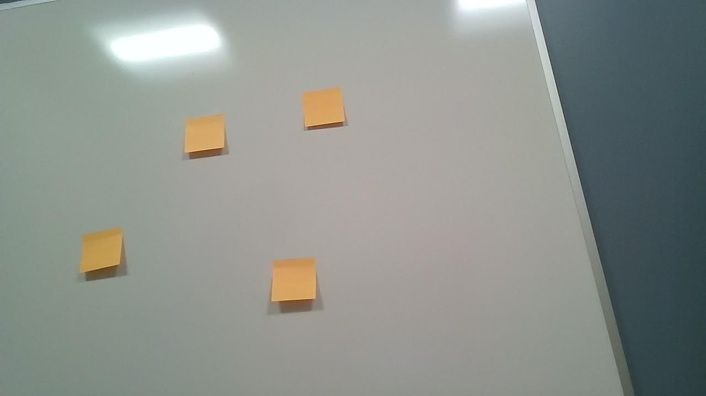
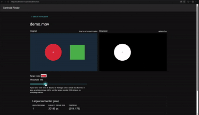

# Centroid Finder - (Overview)
This is essentially an image and video processing app with the purpose of **binarizing image and video data for rendering the largest known centroid within a given color and threshold.** For videos, the app acts as a tracking system that extracts frames using the [JavaCV framework.](https://github.com/bytedeco/javacv) Data is then **extracted into CSV files** formatting seconds (for videos), [x / y] values for located centroids **(see example data below.)**

This app works both as a **backend and frontend pipeline.** For the frontend and details regarding using *Centroid Finder with a UI*, review the [Centroid Finder Frontend Repository](https://github.com/Jaronie/centroid-finder-frontend) which interacts directly with this backend's API.

## Prerequisites
* `JDK 21`
* Maven available on `PATH` for JAR build and execute
* FFmpeg available on `PATH` for server thumbnails / tests

**Key Dependencies:**
* `JUnit Jupiter 5.10.0`
* `JavaCV 1.5.14`


## Build Guide - (Maven, Springboot)

### 1. Build the JAR 
#### `Windows`
``` bash
cd processor
mvn package "-Djavacpp.platform=windows-x86_64"
```
#### `Linux x86-64`
``` bash
cd processor
mvn clean package -Djavacpp.platform=linux-x86_64
```
#### `macOS, Intel`
``` bash
cd processor
mvn clean package -Djavacpp.platform=macosx-x86_64
```
#### `macOS, Apple Silicon`
``` bash
cd processor
mvn clean package -Djavacpp.platform=macosx-arm64
```
``` The created JAR has a default path stored in processor/target/centroidFinder.jar ```
### 2. Run the executable
```bash
java -jar target\centroidFinder.jar 
`sampleInput\yourvideo.mp4`
  FFA200`
  164`
  centroids.csv
  ```

`Arguments for the CLI are:`
- Input video
- Target color in RRGGBB hexadecimal format
- Integer threshold (how close in euclidean value the color should exist from target)
- Optional output CSV path

## Processing and Server - (How It Works)

### Processor 
Written with the Maven module & JavaCV framework is the **processing pipeline**. Configured with ``pom.xml -(processor\pom.xml)`` The ``processor/`` directory contains the Maven module, image/video processing algorithms and JavaCV workflow.

### 1. Run processor tests

` From the repository root `
``` bash
cd processor
mvn test
```

` Tests and compiled output is found under processor/target`

### See build instructions for JAR execution. Optional arguments supported by `VideoSummaryApp.java`
```
java -jar target\centroidFinder.jar video.mp4 FFA200 164 output.csv --scale=0.5
java -jar target\centroidFinder.jar video.mp4 FFA200 164 output.csv --inset=40
java -jar target\centroidFinder.jar video.mp4 FFA200 164 output.csv --crop=100,100,640,480
```

```inset``` and ```crop``` are optional arguments used to limit search areas for the target areas in each frame. They're useful for centroids that especially go off frame or near the edge of a frame.

### Server

### 2. Run server tests & start server
``` bash
cd server
mvn tests
```
#### Starting the server
```bash
cd server
mvn spring-boot:run
```
The server defaults to port `8081`.


## Project Structure
```
centroid-finder/
centroid-finder/
├── .github/
│   └── workflows/
│       ├── run-tests.yml
│       └── server-tests.yml
├── .vscode/
│   └── settings.json
├── frames/                         # Extracted video frames
├── lib/
│   └── junit-platform-console-standalone-6.0.3.jar
├── processor/                      # Image/video processing Maven module
│   ├── pom.xml
│   ├── sampleInput/
│   │   ├── ensantina.mp4
│   │   └── squares.jpg
│   ├── sampleOutput/
│   │   ├── binarized.png
│   │   └── groups.csv
│   └── src/
│       ├── main/
│       │   ├── README.md           # README containing course assignment guidelines
│       │   └── java/io/github/jaronie/centroidFinder/
│       │       ├── ImageSummaryApp.java
│       │       ├── VideoSummaryApp.java
│       │       ├── VideoPipeline.java
│       │       ├── FrameExtractor.java
│       │       ├── ...processing classes
│       │       └── ...image/video helper classes
│       └── test/
│           └── java/io/github/jaronie/centroidFinder/
│               └── ...processor tests
├── server/                         # Spring Boot HTTP API Maven module
│   ├── pom.xml
│   ├── TESTING.md
│   ├── data/
│   │   └── thumbnails/
│   └── src/
│       ├── main/
│       │   ├── java/io/github/jaronie/centroidServer/
│       │   │   ├── CentroidServerApplication.java
│       │   │   ├── config/
│       │   │   ├── model/
│       │   │   ├── service/
│       │   │   └── web/
│       │   └── resources/
│       │       └── application.properties
│       └── test/
│           ├── java/io/github/jaronie/centroidServer/
│           │   └── ...server tests
│           └── resources/fixtures/
│               └── testclip.mp4
├── README.md
├── LICENSE
├── notes.md
├── goals.md
├── ideas.md
├── options.md
├── plan.md
├── serverPlan.md
├── humanImprovements.md
├── robotImprovements.md
├── polish.md
├── plan.png
└── thumb.jpg
```

## Extraction Data - (with examples)
# Sample Input - Images

### squares.jpg - sample image


### binarized.jpg - after executing the JAR 


### (Video Example) Binarizing images with cropping


### (Video Example) Processing CSV Output


### Sample CSV Output for binarized.jpg

```SIZE / X / Y ```
```
6987,533,510
5564,185,453
5187,586,195
5115,371,244
7,617,229
7,377,280
6,592,233
5,611,231
5,573,235
5,373,286
4,599,232
4,582,234
2,564,236
2,507,552
2,501,556
2,497,558
2,196,487
1,551,550
1,546,551
1,371,281
1,368,282
1,228,470
1,167,494
1,152,498
```

# Documentations
* Instructions regarding running the frontend [can be found here.](https://github.com/Jaronie/centroid-finder-frontend)
* For test documentation, review [the testing docs.](server\TESTING.md)
* This is a coursework assigned project. For original project instructions, review [the processor's README.](processor/src/main/README.md)